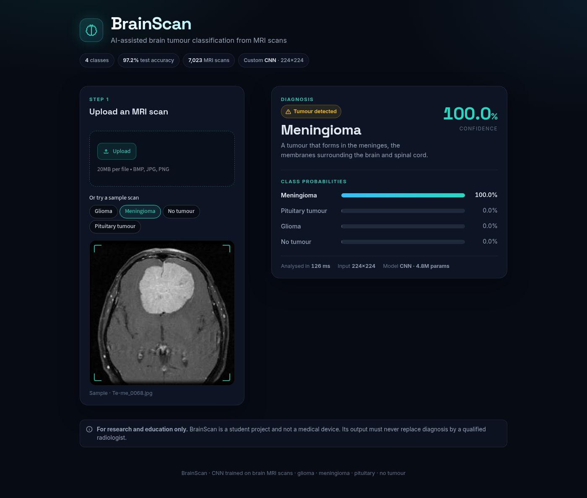
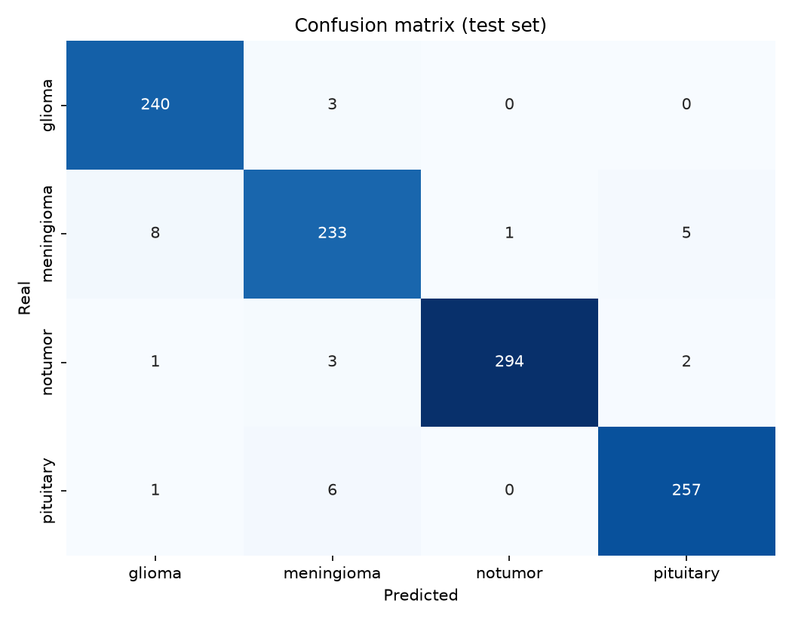

# BrainScan

**Brain tumour classification from MRI scans with a convolutional neural network, served through a Streamlit web app.**

BrainScan takes a brain MRI image and predicts one of four classes: **glioma**, **meningioma**, **pituitary tumour** or **no tumour**. The CNN reaches **97.15 % accuracy** on a held-out test set of 1,054 scans.



> ⚠️ Student project for research and education only. It is not a medical device and must never replace diagnosis by a qualified radiologist.

---

## Contents

- [Context](#context)
- [Dataset](#dataset)
- [Pipeline](#pipeline)
- [Results](#results)
- [Installation](#installation)
- [Usage](#usage)
- [Project structure](#project-structure)
- [Reproducibility](#reproducibility)

## Context

Brain tumours are diagnosed by radiologists reading MRI scans, which is slow and needs scarce expertise. The goal of this project is to build an image classifier that can flag the type of tumour visible on a scan, and to make it usable by non-technical people through a simple web interface.

## Dataset

[Brain Tumor MRI Dataset](https://www.kaggle.com/datasets/masoudnickparvar/brain-tumor-mri-dataset) (Kaggle, Masoud Nickparvar): **7,023 MRI images** in 4 classes.

| Class | Images | Share |
|---|---:|---:|
| glioma | 1,621 | 23.1 % |
| meningioma | 1,645 | 23.4 % |
| notumor | 2,000 | 28.5 % |
| pituitary | 1,757 | 25.0 % |

The classes are only mildly imbalanced (largest / smallest = 1.23), so no resampling is applied. A stratified split keeps these proportions in every set.

The dataset is not stored in the repository. Download it and merge the Kaggle `Training/` and `Testing/` folders into one folder per class:

```
Data/
├── glioma/
├── meningioma/
├── notumor/
└── pituitary/
```

## Pipeline

| Step | What happens | Code |
|---|---|---|
| 1. Cleaning | Files with an invalid extension, empty files and images OpenCV cannot decode are reported (and removed with `--remove-bad-files`). | `brainscan.data.clean_dataset` |
| 2. Resizing | Every image is resized to **224×224** with `cv2.INTER_AREA` into `Resized_data/`. | `brainscan.data.resize_dataset` |
| 3. Loading | Images (BGR) go into one NumPy array, their folder names into a label array. | `brainscan.data.load_dataset` |
| 4. Split | Stratified **85 % train / 15 % test** (`random_state=42`), labels encoded with `LabelEncoder`. 15 % of the training set is used for validation. | `brainscan.data.split_dataset` |
| 5. Model | 5 × (Conv2D → BatchNorm → MaxPool) blocks with 32→512 filters, then Dense(128) + Dropout(0.5) and a softmax over 4 classes. Data augmentation (flip, rotation, zoom, contrast) and the 0–1 rescaling are layers inside the model. **4.78 M parameters.** | `brainscan.model.build_model` |
| 6. Training | Adam, sparse categorical cross-entropy, 30 epochs, batch size 32. `ModelCheckpoint` keeps the epoch with the lowest validation loss. | `brainscan.train` |
| 7. Evaluation | The **best checkpoint** is evaluated on the test set: accuracy, loss, classification report, confusion matrix. | `brainscan.evaluate` |
| 8. Prediction | `predict_image(path)` validates the file, applies the same preprocessing as training and returns the class and all probabilities. | `brainscan.predict` |

The exploration and the experiments are in [`notebooks/main.ipynb`](notebooks/main.ipynb). The `src/brainscan/` package contains the same steps as reusable, documented code.

## Results

Best checkpoint on the test set (1,054 images never used for training or validation):

| Metric | Value |
|---|---:|
| **Accuracy** | **97.15 %** |
| Loss | 0.0887 |
| Macro F1 | 0.971 |

| Class | Precision | Recall | F1 |
|---|---:|---:|---:|
| glioma | 0.960 | 0.988 | 0.974 |
| meningioma | 0.951 | 0.943 | 0.947 |
| notumor | 0.997 | 0.980 | 0.988 |
| pituitary | 0.973 | 0.973 | 0.973 |



- **Meningioma** is the hardest class: most errors are meningiomas predicted as glioma (8) or pituitary (5).
- **No tumour** is almost never confused with a tumour: 6 misses out of 300, which matters most for a screening tool.
- The model evaluated at the last training epoch scored 93.36 %. Its validation loss had gone up again, which is why the checkpoint with the best validation loss is kept and used everywhere.

Full metrics: [`reports/metrics.json`](reports/metrics.json).

## Installation

Requires **Python 3.11+**. A CUDA GPU is optional but makes training much faster.

With [uv](https://docs.astral.sh/uv/) (recommended):

```bash
git clone https://github.com/jerymy-k/BrainScan.git
cd BrainScan
uv sync
```

Or with pip:

```bash
git clone https://github.com/jerymy-k/BrainScan.git
cd BrainScan
python -m venv .venv && source .venv/bin/activate
pip install -r requirements.txt
```

Then download the dataset into `Data/` (see [Dataset](#dataset)).

## Usage

The trained model (57 MB) is not stored in git. Train it once first: it is saved to `models/best_brain_tumor_model.keras`.

**Train** (clean → resize → split → train → evaluate, about 12 min on a laptop GPU):

```bash
uv run brainscan-train
```

Options: `--epochs`, `--batch-size`, `--seed`, `--early-stopping`, `--remove-bad-files`, `--model-path`, `--reports-dir`. Reports (metrics, confusion matrix, training curves) are written to `reports/`.

**Evaluate** an existing model on the test set:

```bash
uv run brainscan-evaluate
```

**Run the web app**, from the project root:

```bash
uv run streamlit run app/app.py
```

Upload an MRI image (`.jpg`, `.jpeg`, `.png`, `.bmp`) or pick a sample scan. The app shows the predicted class, its confidence and the probability of every class. Invalid or corrupted files get a clear error message.

**Predict from Python:**

```python
from brainscan.predict import predict_image

result = predict_image('path/to/scan.jpg')
print(result['label'], result['confidence'])     # e.g. glioma 0.998
print(result['probabilities'])                    # probability of each of the 4 classes
```

## Project structure

```
BrainScan/
├── app/
│   └── app.py              Streamlit interface
├── src/brainscan/
│   ├── config.py           paths, image size, classes, training defaults
│   ├── data.py             cleaning, resizing, loading, splitting
│   ├── model.py            CNN architecture
│   ├── train.py            end-to-end training (brainscan-train)
│   ├── evaluate.py         test-set evaluation and reports (brainscan-evaluate)
│   └── predict.py          single-image prediction with input validation
├── notebooks/main.ipynb    exploration and experiments
├── models/                 trained model (not in git)
├── reports/                metrics and figures
├── docs/                   README images
├── .streamlit/config.toml  app theme
├── pyproject.toml          dependencies and CLI commands
├── requirements.txt        pinned dependencies (exported from uv.lock)
└── uv.lock
```

## Reproducibility

- **Pinned dependencies:** `uv.lock`, and `requirements.txt` exported from it with `uv export --format requirements-txt -o requirements.txt`.
- **Seeds:** `brainscan-train` seeds Python, NumPy and TensorFlow (`--seed`, default 42). The train/test split uses `random_state=42`, so the test set is always the same 1,054 images: `brainscan-evaluate` gives exactly the numbers above.
- **Training on a GPU** can still vary slightly between runs because some CUDA operations are non-deterministic, so expect accuracy close to, but not exactly, 97.15 % when retraining.
- **One preprocessing path:** training and prediction both read images with OpenCV (BGR) and resize to 224×224 with `INTER_AREA`, and pixel rescaling lives inside the model, so the app sees exactly what the model was trained on.
